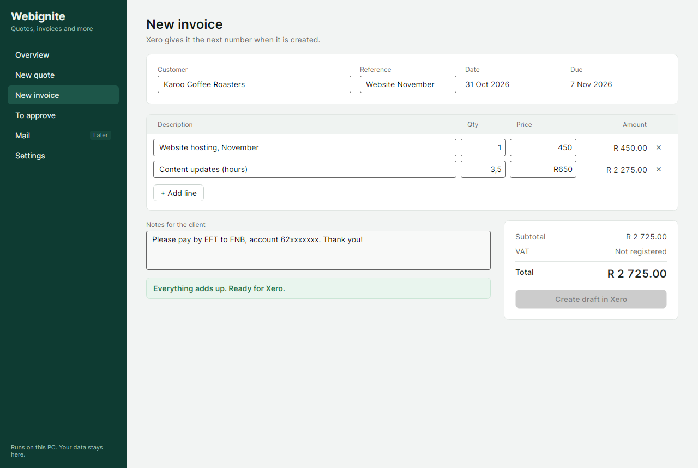

# Webignite Desktop

Native Windows software for Webignite's quotes and invoices, built to grow into email and more. It runs on your PC and keeps your data there. No browser engine, no Electron, no server.



## What it does now

- **New quote** and **New invoice** screens. Type a customer and lines and the totals, date and due date fill in as you go. Amounts like `3,5` or `R650` are read correctly.
- Every document goes through the same checks that will apply to documents Claude and ChatGPT prepare: totals must add up to the cent, no VAT (Webignite is not VAT registered), and dates and lines must make sense.
- **Quotes** and **Invoices** lists. Documents save to an encrypted database on this PC (`%LOCALAPPDATA%\Webignite`).
- **Clients**: one page per client with contact details and notes, plus their quotes, invoices, to-dos and upcoming events. Names already on quotes and invoices can be saved as clients with one click.
- **To-do**: quick-add tasks grouped into Overdue, Today, Coming up and No date. Reminders appear by themselves to follow up quotes, chase overdue invoices and finish old drafts.
- **Calendar**: month view with events you add, plus to-dos, quote expiry dates and invoice due dates filled in automatically. Kept on this PC only.
- **Planner**: the week at a glance, with undated to-dos waiting to be given a day.
- **Overview**: money owed, overdue and quoted, plus everything on today.
- **Settings**: connect Xero and set default due and expiry days. Xero sign-in opens in your own browser; the app never sees your Xero password, and the sign-in is kept in Windows Credential Manager.
- The Xero draft format and the read-back check are ready. Creating drafts in Xero is the next step.

## Coming next

1. Create drafts in Xero from the editor, with customer matching.
2. The **To approve** list, plus the connector for Claude Desktop and ChatGPT.
3. Approve and send invoices from accounts@webignite.co.za, using the Xero PDF and your own email templates.
4. Installer with automatic updates and encrypted backups.
5. Mail, with a native HTML viewer, plus the assistant tools to read and draft replies.

## Connecting Xero

1. At [developer.xero.com/app/manage](https://developer.xero.com/app/manage), create a new app of type **Mobile or desktop app (PKCE)**, with redirect URI `http://localhost:47310/callback`.
2. Copy its Client ID into Settings in the app and click Connect Xero.

## Building

You need the [.NET 10 SDK](https://dotnet.microsoft.com/download/dotnet/10.0).

```
dotnet run --project src/Webignite.Desktop        # open the app
dotnet test --solution Webignite.slnx             # run the tests
dotnet run --project tools/Snapshot -- shots       # save screenshots of each screen
```

## Layout

| Project | What it holds |
|---|---|
| `src/Webignite.Core` | Documents, money rules, defaults and checks. No UI, no network. |
| `src/Webignite.Data` | The local database. Everything except ids, kinds, statuses and timestamps is encrypted with AES-256-GCM; the key is protected by Windows (DPAPI). |
| `src/Webignite.Xero` | Xero sign-in (PKCE), the draft format and the check that Xero saved what was sent. |
| `src/Webignite.Desktop` | The Avalonia app. Each sidebar entry is a module. |
| `tests/Webignite.Tests` | Tests for Core and Xero. |
| `tools/Snapshot` | Renders screens to PNG without opening a window. |

Colours live in `src/Webignite.Desktop/Styles/Palette.axaml`. Change that one file to try a different palette.

## Ground rules

- Drafts only. The app never sends, approves, emails or records payments in Xero without a person clicking.
- Assistants can prepare documents and replies, but only a person can approve them.
- Money is always `decimal`, rounded half away from zero to the cent.
- Never retry a write to Xero when the outcome is unclear. Check what Xero has first.
