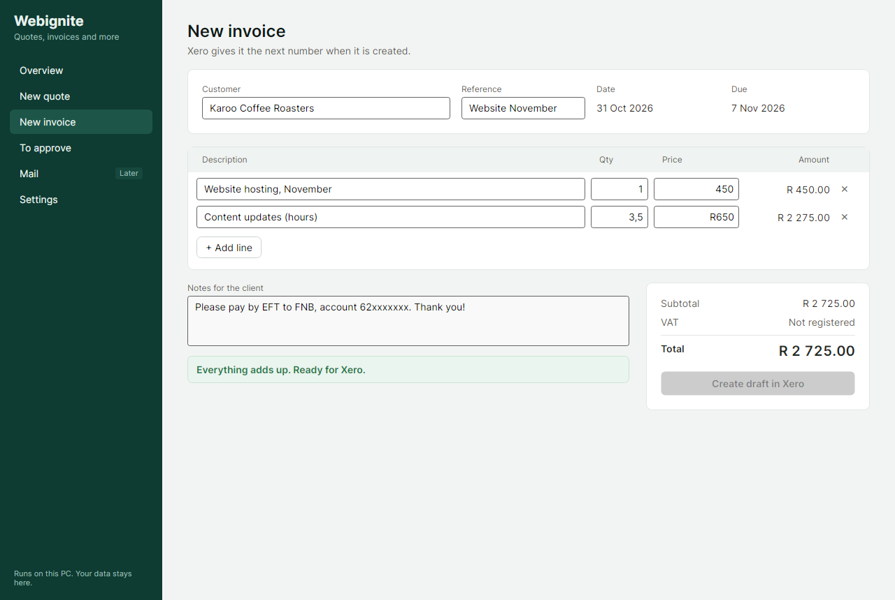

# Webignite Desktop

Native Windows software for running Webignite: quotes, invoices, clients, mail and the small web tools the work needs. It runs on your PC and keeps your data there. No browser engine, no Electron, no server.



## What it does

**Billing.** Quotes and invoices with totals that fill in as you type, a price list for one-click lines, copy a document or make an invoice from a quote, search and filters. Documents go to Xero as drafts, you approve them in the app, and the invoice is emailed from your own mailbox with Xero's PDF. Payments are read back from Xero so money owed is right. Monthly statements, overdue reminders and quote follow-ups are drafted for you.

**Clients.** One page per client: contact details, notes and linked files, their documents, mail, to-dos, projects, time and a new-site checklist. Retainers draft their invoice on the day. Domains and hosting renewals raise a to-do and, if the client pays, the renewal invoice.

**Money.** Money received and expenses month by month, recurring expenses added on their day, an income projection (expected against came in, 12 months, with a chart) and reports for the tax year (1 March to February).

**Planning.** To-do, calendar, weekly planner and time tracking (a timer or typed-in hours, for a client, a project or nobody).

**Mail.** Both mailboxes over IMAP and SMTP (MailKit), read in a native HTML viewer with scripts off and remote images blocked. Write with bold, lists, links, signature pictures and drag-and-drop attachments. Mail is checked in the background and new mail is announced. Address suggestions come from clients and past mail. Organise it with your own categories (coloured dots, kept on the server as IMAP keywords so Thunderbird and phones see them), an Important mark, quick filters, your own folders, Archive, a right-click menu, several messages at once, drag onto a folder, and keys.

**Web tools.** Site check (DNS, MX, SPF, DKIM, DMARC, RDAP and a PageSpeed run, with results kept), uptime and certificate watch for client sites, a mark-up tool for screenshots, image resizing and WebP, calculator, password generator, colour picker and QR codes.

**Assistants.** `Webignite.Connector` is an MCP server that Claude Desktop and ChatGPT start locally. They can search and read mail, draft replies, list and prepare quotes and invoices, and read and add to-dos. Only a person approves or sends.

**Everything else.** Encrypted daily backups, Ctrl+K search across everything, a morning summary, keyboard shortcuts, Undo after removing, light and dark looks with a motion setting, in-app updates from GitHub releases.

## Connecting Xero

1. At [developer.xero.com/app/manage](https://developer.xero.com/app/manage), create a new app of type **Mobile or desktop app (PKCE)**, with redirect URI `http://localhost:47310/callback`.
2. Copy its Client ID into Settings in the app and click Connect Xero.

Sign-in opens in your own browser; the app never sees your Xero password. The refresh token is kept in Windows Credential Manager.

## Building

You need the [.NET 10 SDK](https://dotnet.microsoft.com/download/dotnet/10.0). The SDK version is pinned in `global.json`.

```
dotnet build Webignite.slnx                        # build everything, warnings are errors
dotnet test --solution Webignite.slnx             # run the tests
dotnet run --project src/Webignite.Desktop        # open the app
dotnet run --project tools/Snapshot -- shots       # save screenshots of each screen (works on Linux too)
```

CI builds and tests every pull request on Windows. Every merge to `main` publishes a release that installed copies pick up on their next start (`.github/workflows/release.yml`).

To add a page, a setting, a table, a background check, an assistant tool or a test, see [docs/adding-things.md](docs/adding-things.md).

## Layout

| Project | What it holds |
|---|---|
| `src/Webignite.Core` | The rules: documents, money, clients, retainers, renewals, time, mail models and formatting, web checks, small tools. No UI, no network, no packages. Everything here has tests. |
| `src/Webignite.Data` | The local SQLite database (`LocalStore`), encryption (`Vault`, key under DPAPI), backups, secrets, the app log, and what assistants are allowed to read and write. |
| `src/Webignite.Xero` | Xero sign-in (PKCE), the accounting API calls, draft creation and the check that Xero saved what was sent. |
| `src/Webignite.Mail` | IMAP and SMTP through MailKit, syncing into the local store, sending, and the assistant mail tools. |
| `src/Webignite.Services` | The checks that run on their own: payments read from Xero, client sites visited for uptime, domain and speed checks. No UI; each takes its connections in its constructor so tests can hand it fakes. |
| `src/Webignite.Desktop` | The Avalonia app. View models under `ViewModels`, views under `Views`, custom controls under `Controls`, colours and styles under `Styles`. Each sidebar entry is a `Module`. |
| `src/Webignite.Connector` | The MCP server Claude Desktop and ChatGPT start. Talks over stdin and stdout; logs go to stderr. |
| `tests/Webignite.Tests` | xUnit tests for Core, Data, Xero, Mail and Services. Xero and mail are tested against fake HTTP handlers. |
| `tools/Snapshot` | Renders every screen to PNG without opening a window, using a throwaway database with sample data. |

Colours live in `src/Webignite.Desktop/Styles/Palette.axaml` and the three `Palette.Dark.*.axaml` files, which all hold the same names. The only other colours are inside mail itself: mail is shown on white paper in every look, so its base text colour is written into the mail's own HTML.

## Where things live on the PC

| What | Where |
|---|---|
| Database, vault key, settings | `%LOCALAPPDATA%\Webignite` (`WEBIGNITE_DATA_DIR` overrides it) |
| Log files, kept 14 days | `%LOCALAPPDATA%\Webignite\logs` |
| Backups | The folder chosen in Settings, by default `Webignite backups` in OneDrive or Documents |
| Mailbox passwords, Xero token, backup password | Windows Credential Manager |
| The installed app | `%LOCALAPPDATA%\WebigniteDesktop` (Velopack) |

## Ground rules

- Drafts only. The app never sends, approves, emails or records payments in Xero without a person clicking.
- Assistants can prepare documents and replies, but only a person can approve them.
- Webignite is not VAT registered. Money is always `decimal`, rounded half away from zero to the cent, shown as `R 1 234.56`.
- Never retry a write to Xero when the outcome is unclear. Check what Xero has first.
- Business rules go in `Webignite.Core` with a test, never in a view model.
- Records are JSON inside encrypted blobs, read with `StoredJson`: a new field needs no migration, and a field this version doesn't know is skipped. Assistant input is read strictly with `DocumentJson`.
- Plain South African English in the UI, no em dashes. Red means a problem and green means done, nothing else.
