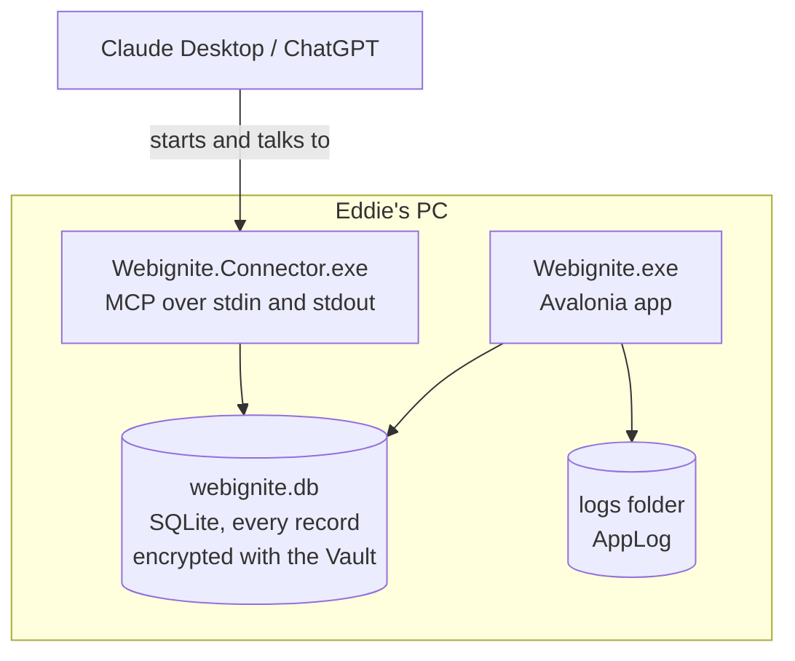
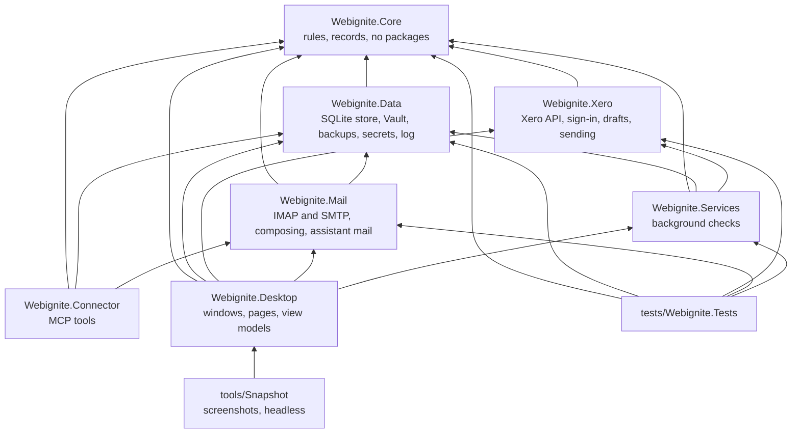
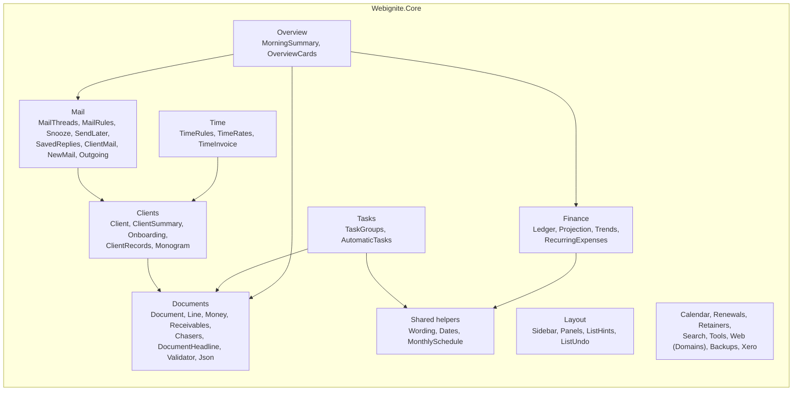
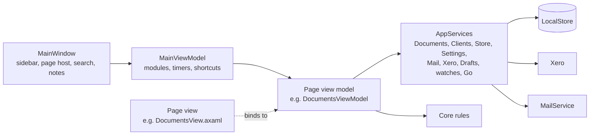
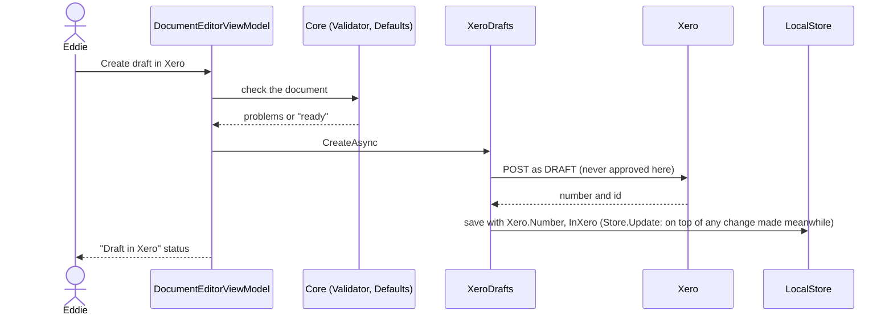
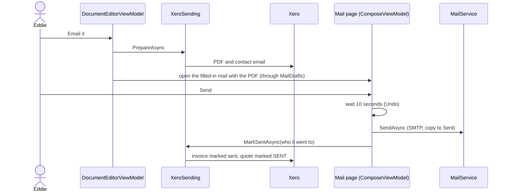
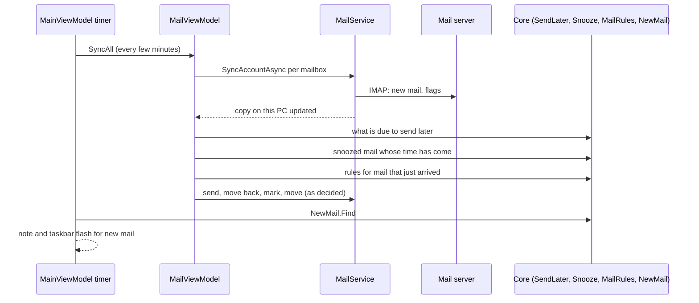
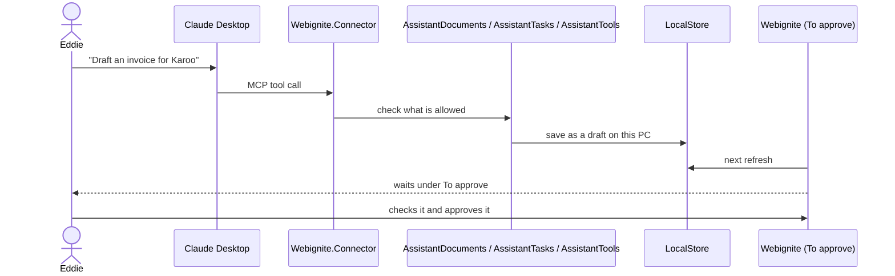

# How Webignite is put together

A map of the app in four levels, using the C4 model: what Webignite talks to, the programs it is made of, the parts inside each, and how the main jobs flow through them. The diagrams are Mermaid, so GitHub draws them. Keep this file up to date in the same PR when a project, a page, a store or an outside service is added or removed.

Recipes for adding things are in [adding-things.md](adding-things.md). The house rules are in [CLAUDE.md](../CLAUDE.md).

## 1. What Webignite talks to

One person (Eddie) uses one Windows PC. Everything is kept on that PC; outside services are only reached for the job they do.

| Outside service | What for | Where in the code |
| --- | --- | --- |
| Xero | Quotes and invoices go in as DRAFT; payments and statuses are read; PDFs fetched for emailing. Sign-in is OAuth with PKCE in the browser. | `Webignite.Xero` |
| Mail server | Mail is read over IMAP into a copy on this PC and sent over SMTP. | `Webignite.Mail` (MailKit) |
| Claude Desktop, ChatGPT | They start `Webignite.Connector`, which offers tools over MCP. | `Webignite.Connector` |
| Websites, Google PageSpeed, rdap.org, dns.google, Cloudflare DNS | Site check, uptime watch, domain and hosting reports. | `Webignite.Services`, `Core/Web` |
| OneDrive folder | Backups land in a synced folder, encrypted with a password. | `Webignite.Data/Backups.cs` |
| GitHub releases | Velopack checks for and downloads updates. | `Desktop/ViewModels/UpdateViewModel.cs` |
| Windows | Credential Manager holds mail passwords and the Xero sign-in; DPAPI protects the database key. | `Webignite.Data/Secrets.cs`, `VaultKey.cs`, `Webignite.Xero/WindowsCredentialStore.cs` |

## 2. The programs and projects

Two programs run on the PC, the app and the connector, and they share one encrypted database file.

### Projects and what may use what

Arrows point at what a project uses. Core uses nothing, so every rule in it can be tested on its own.

| Project | Holds | Outside packages |
| --- | --- | --- |
| `Webignite.Core` | Every business rule and record: documents, money, clients, mail rules, time, layout, and `Writing` (formatted writing for the mail editor). Pure functions with dates passed in. | none |
| `Webignite.Data` | `LocalStore` (SQLite, one table per kind of record, payload encrypted by `Vault`; one file per area on the shared helpers in `LocalStore.Rows.cs`, and `LocalStore.Schedules.cs` for what the calendar calls for, `LocalStore.Upgrades.cs` for the steps that bring older data up to date), `VaultKey`, backups, secrets, `AppLog`, the assistant rules for documents and to-dos. | Microsoft.Data.Sqlite, ProtectedData |
| `Webignite.Xero` | `XeroSession` (sign-in, tokens), `XeroApi`, `XeroDrafts` (create and check drafts), `XeroSending` (PDFs, mark sent), `XeroStandings` (payments). | none |
| `Webignite.Mail` | `MailService` (sync, read, mark, move, send; `MailRetry` decides when a dropped connection is tried again), `MailComposer`, `MailReader`, `AssistantTools` (what an assistant may do with mail). | MailKit |
| `Webignite.Services` | `DocumentService` and `ClientService`, through which pages read and change quotes, invoices and clients (each change applied to the record as stored now); `PaymentWatch`, `UptimeWatch`, `SiteChecker`: each has `Due(now)` and `RunAsync`. | none |
| `Webignite.Connector` | The MCP server and its tools: documents, to-dos, mail. Logs go to stderr only. | ModelContextProtocol, Hosting |
| `Webignite.Desktop` | The app: `AppServices`, `AppSettings`, `Navigator`, `MailDrafts`, `BackgroundJobs`, `MailCheck`, `TimerClock`, pages (view models and views), controls, styles. | Avalonia, CommunityToolkit.Mvvm, HtmlRenderer, Velopack |
| `Webignite.Tools` | The heavier tools: PDF pages (`PdfPages`), picture shrinking (`ImageShrinker`), QR codes (`QrCodes`), and later PDF editing, the image viewer and recording. Only read from disk when a tool is first used. | Docnet.Core, QRCoder, Avalonia.Skia |
| `tests/Webignite.Tests` | xUnit v3 tests, one file per area. | xunit.v3 |
| `tools/Measure` | Opens the app on a year of made-up work and measures start-up time and memory, then opens and lets go of every page twice, checking each page and its screen are freed and nothing is left behind. Fails past `limits.json`; CI runs it and puts the numbers in the run's summary. | Avalonia.Headless |
| `tools/Snapshot` | Builds sample data in a throwaway database, saves a screenshot of each screen and runs checks along the way (a failed check fails the run). CI runs it on every pull request and keeps the pictures. | Avalonia.Headless |

## 3. Inside the projects

### Core: rules by area

Some rules are written once and used everywhere; a second copy is a bug waiting to happen. Days in words are `Wording`, weeks, months and tax years are `Dates`, anything monthly is `MonthlySchedule`, names are compared with `ClientDirectory.Key`, addresses are matched with `ClientMail`, websites become domains with `Web.Domains.Of`, and typed amounts are read with `Money.Parse`.

### Desktop: how a page is built

Every page is a `Module` in the sidebar: a view model (`ViewModels/ThingViewModel.cs`) shown by its view (`Views/ThingView.axaml`). View models call Core for decisions and `AppServices` for everything else.

| Piece | Job |
| --- | --- |
| `AppServices` | One of each long-lived thing: the store, `Documents` and `Clients` (the services pages use for those), settings, mail, Xero session, watches, `Navigator`, `MailDrafts`, notes, background work. |
| `MailDrafts` (`services.Drafts`) | The one way a mail is prepared for the person to send: invoice and quote mail, reminders, statements, onboarding reminders, mark-ups. Nothing is sent from code. |
| `IRefreshable` | A page that shows what other pages change reads it again when it is opened and on F5. |
| Open pages | A sidebar entry is a `Module`; what is open is a `PageHost`. Each module has its main copy (`Module.Main`), and a page can be open more than once (`MainViewModel.OpenAnother`, `Close`): two Mails, two Clients, each with its own state. `MainViewModel.Open` lists every open copy and `Current` is the one on screen; the sidebar and jumps go to the copy of a page used last. Telling pages something changed, and saving before the app closes, goes to every built copy (`Built<T>`). `MainViewModel.Tabs` (in `MainViewModel.Tabs.cs`) is the tab strip, shown once there are two: whatever comes on screen takes the place of what the tab showed unless it has a tab already, `OpenInNewTab` (Ctrl+click or a middle click in the sidebar, on a client, or a middle click on a mail) adds one, `CloseTab` won't close one with work open, and the tabs are saved under "tabs" when the app closes (`TabRules` in Core). A page that is `ITabTitle` names its tab after what is open in it. |
| Pop-out windows | `MainViewModel.PoppedOut` (in `MainViewModel.PopOut.cs`) holds pages taken out of the strip into windows of their own: drag a tab down out of the strip or out of the window, or right-click it and choose Open in new window. `MainWindow.PopOut.cs` makes a `PageWindow` for each and closes it when the page goes back; dragging a `PageWindow`'s header onto the main window's tabs puts the page back (`DockBack`), and closing the window closes the page, or puts it back when it has work open. Popped-out windows and where they were are saved with the tabs. The sidebar and jumps never take over a popped-out page: the main window gets its own copy. |
| Side by side | `MainViewModel.Beside` (in `MainViewModel.Split.cs`) is a second page beside the one on screen: drag a tab to the left or right edge of the page (`TabRules.SideAt`), or right-click it and choose a side. `MainWindow.Split.cs` lays the two out with a divider whose position is kept (`MainShare`). The page beside has its own header to swap sides, go back to being a tab, or close (one with work open goes back to a tab). The sidebar, tabs and jumps act on the main side and never take over the page beside; the split is saved with the tabs. Each side keeps a usable minimum width and scrolls sideways below it. |
| Light by design | A page is built the first time it is opened (`PageHost` holds how to build it), so starting the app builds Overview and nothing else. A page nobody has looked at for `MainViewModel.PageIdle` is let go (`ReleaseIdle`) unless it is `IHoldsWork` with work open; a page that must tidy up (stop a timer, save typing) is `IDisposable`. Mail checks, payments, website checks and backups run in `BackgroundJobs` whichever pages are built, and only tell pages that are; `MailCheck` does the mail part without the Mail page. The running time-tracking timer is `TimerClock`, so the sidebar shows it with Time closed. Nothing at start-up touches a type in `Webignite.Tools`; the screenshot tool checks both. |
| `MainViewModel.PrepareToCloseAsync` | Runs before the window closes: saves open editors, the open client and typed amounts, sends a mail still in its undo wait and saves the mail being written. |
| `AppSettings` | Typed settings saved as JSON under a key in the `settings` table, e.g. `mail-rules`, `mail-snooze`, `income-plan`. |
| `Navigator` (`services.Go`) | Moving between pages and opening a client, a document or a mail, without pages knowing about each other. |
| `Background.Forget` | Runs a task nobody waits for and writes any failure to `AppLog`; with `tell: true` a note says so too. `Background.CatchUnhandled` does the same for any error nobody caught on the screen's thread, and the app carries on. |
| `Feedback` | Timings for small movements (fades, the to-do tick), following the Motion setting. |
| Controls | `PanelGrid` (movable panes), `Sticky` (pinned table headings, on by the `stickyhead` class), `AgendaChip` (a calendar item coloured by kind), `RichTextEditor` (the mail editor, see below), `ListKeys` (arrow keys on lists), `EmptyState`, `ListHint`, `SavedNote`, `Monogram`, `CategoryDot`, `Icon` and `IconConverter`, `Spinner`, `Sparkline`, `ShareBar`, `IncomeChart`, `MarkupCanvas`. |
| Styles | `Palette.axaml` and three dark palettes (the only place colours live, shadows and mark-up pens included), `Controls.axaml`, `Icons.axaml` (Lucide), `Motion.axaml`, and `Views/AgendaChips.axaml` for calendar chips. |
| Shared screen pieces | `Views/LinesEditor` is the lines table on quotes, invoices and retainers. `ClientPicker` builds the client lists pages offer (names to type from, or a drop-down with a first choice like "All clients"). |
| Writing a mail | `ComposeView` holds the format bar and a `RichTextEditor`, which edits a `RichDocument` (`Core/Writing`). Every edit goes through `RichEditing`, which has the tests. `RichHtml` writes the mail's HTML and reads drafts back. `RichText` turns plain text in (templates, saved replies) and out (the text part). The signature is ordinary writing, marked `IsSignature`, so it can be edited, swapped when From changes, and is never added a second time. A draft written here keeps its HTML in a `webignite-body` div, so it reopens exactly. |
| Mail page | `MailView` with the folder tree (`MailFolderNodes.cs`), the list (`MailRowViewModel`) and the reader; `MailRulesView` and `MailSetupView` are its two pages of their own. `MailViewModel` is split by job into partial files (Actions, Editors, Rules, Sending, Snooze). |

### Pages

| Group | Pages |
| --- | --- |
| (top) | Overview, To approve, Mail |
| Client work | Clients, Retainers, Domains and hosting |
| Billing | Quotes, Invoices, Money, Reports |
| Planning | To-do, Calendar, Planner, Time |
| Web tools | Site check, Mark-up, Tools |
| (bottom) | Settings |

### What is stored where

| Table | Holds |
| --- | --- |
| `documents` | Quotes and invoices (`StoredDocument`): the document, then its `Xero` link and what Xero last said, its `Delivery` (approved, emailed, chased) and `Settled` (when and how). |
| `clients` | Clients with notes, files, projects, onboarding, hourly rates. |
| `tasks`, `events` | To-dos and calendar events. |
| `entries`, `recurring` | Money in and out, and monthly costs. |
| `retainers`, `drafts_made` | Retainers and which monthly drafts were already made. |
| `renewals` | Domains and hosting renewals. |
| `time_entries` | Logged time. |
| `mail_accounts`, `mail_folders`, `mail_messages`, `mail_bodies` | The copy of the mail on this PC. |
| `settings` | Every `AppSettings` record, by key. |

Every row's payload is JSON encrypted by the `Vault` with a key tied to the row, so a row can't be copied into another. Only what the database needs to find rows (ids, kinds, dates) is in the clear.

## 4. How the main jobs flow

### A quote or invoice goes to Xero

### An invoice is emailed

Approving the invoice and marking it sent are the only Xero writes that aren't drafts, and they happen only from the person's own click on Email it. Claude and ChatGPT never get this far.

### Mail arrives

### An assistant prepares something

### Payments and sites are checked in the background

`MainViewModel` ticks every minute and asks each watch whether it is `Due(now)`. `PaymentWatch` reads open invoices from Xero and `Receivables.Apply` decides what changed; `UptimeWatch` visits watched sites and `Uptime` decides what to say. Findings come up as notes in the corner and lines on Overview.

## Where new code goes

| Adding | Put it in |
| --- | --- |
| A rule, calculation or decision | `Webignite.Core/<Area>`, with a test in `tests/Webignite.Tests` |
| A new kind of record that is saved | Core record + a table and `LocalStore.Thing.cs` in `Webignite.Data` |
| A setting | A record in Core (or `Desktop` when it is only about the app), a property on `AppSettings` |
| A mail the person sends | `services.Drafts` (`MailDrafts`) |
| Work that mustn't be lost when the app closes | A line in `MainViewModel.PrepareToCloseAsync` |
| A page | View model, view, icon, `Page` value, `Module` in `MainViewModel` |
| A background check | A class in `Webignite.Services` with `Due` and `RunAsync` |
| Something an assistant can do | A tool in `Webignite.Connector`, its rule in `Assistant*` |
| A colour | All four palette files |
