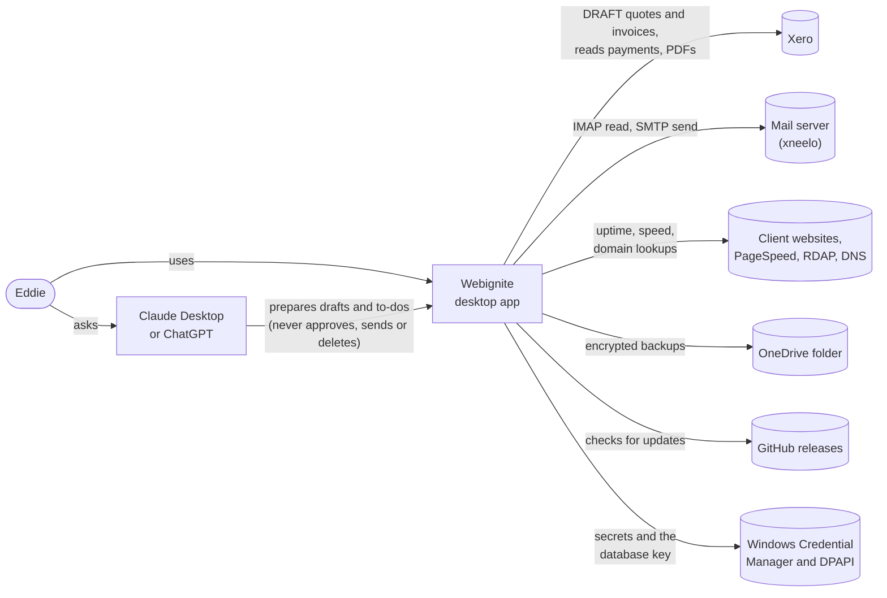
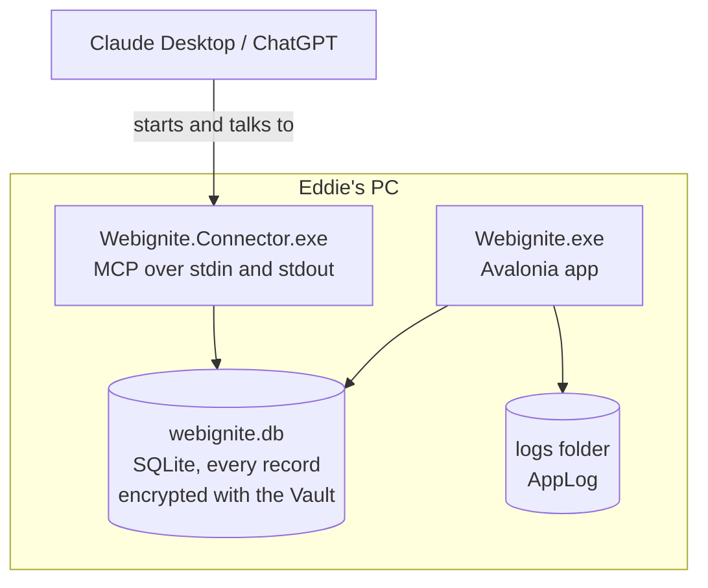
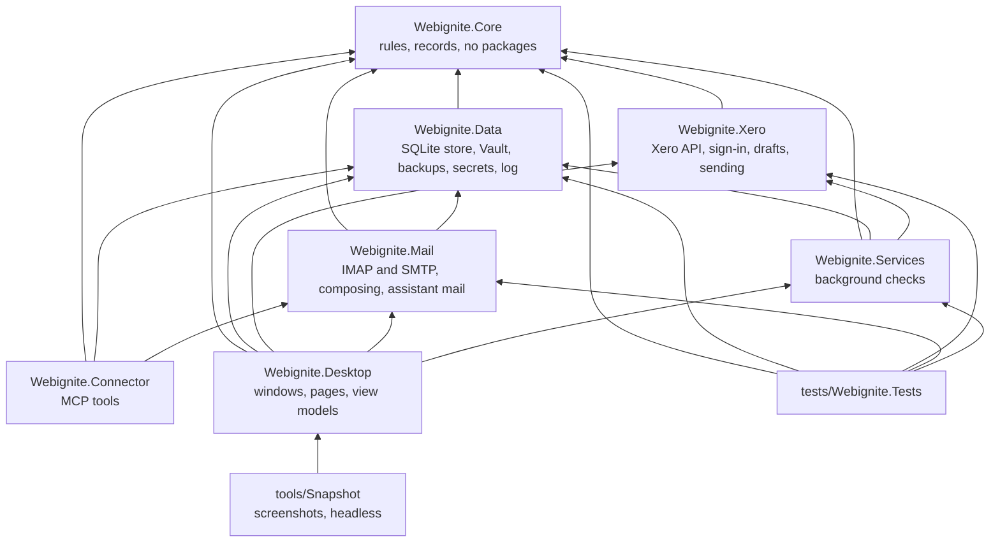
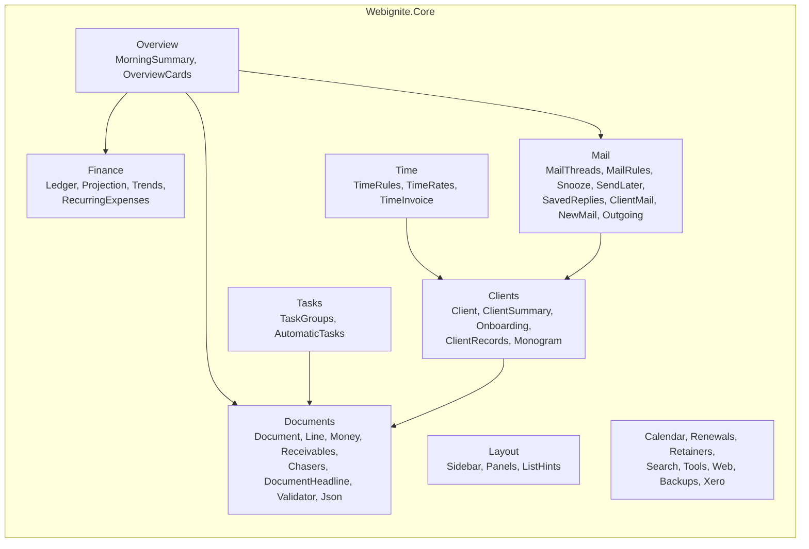
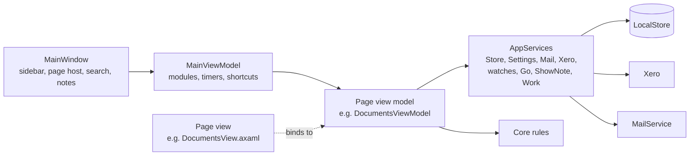
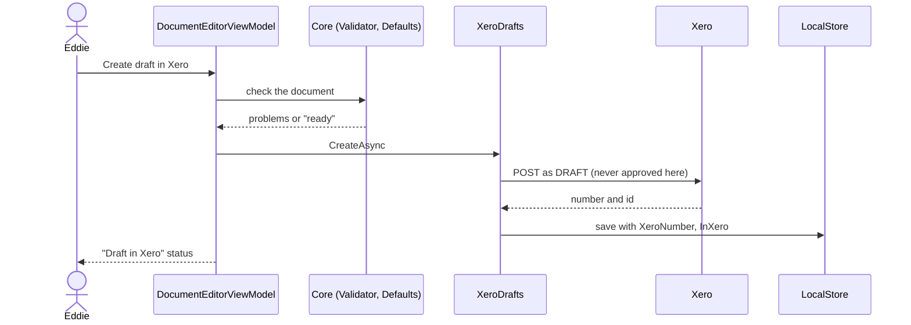
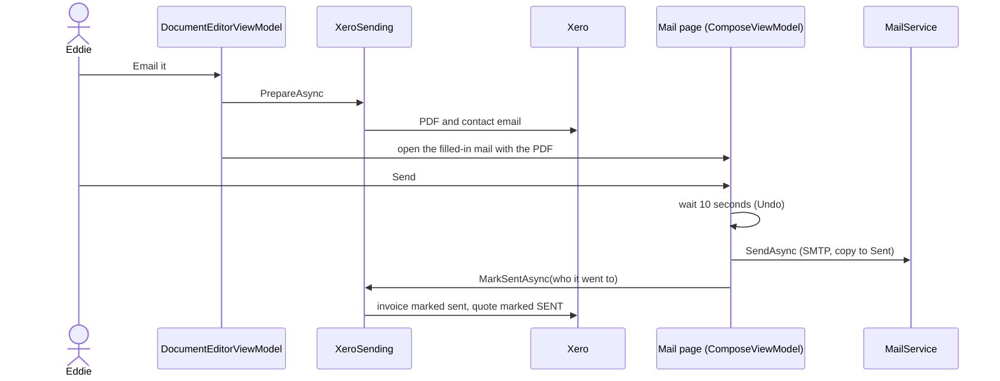
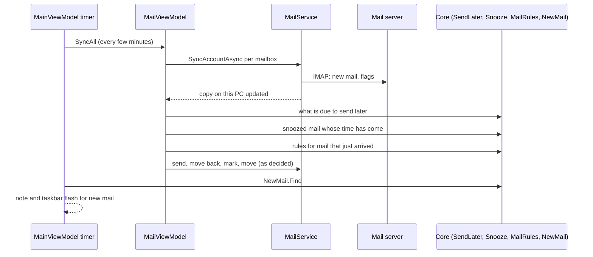
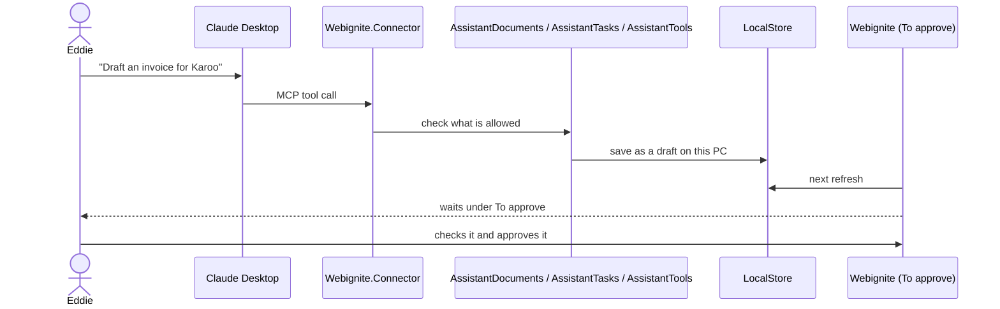

# How Webignite is put together

A map of the app in four levels, using the C4 model: what Webignite talks to, the programs it is made of, the parts inside each, and how the main jobs flow through them. The diagrams are Mermaid, so GitHub draws them. Keep this file up to date in the same PR when a project, a page, a store or an outside service is added or removed.

Recipes for adding things are in [adding-things.md](adding-things.md). The house rules are in [CLAUDE.md](../CLAUDE.md).

## 1. What Webignite talks to

One person (Eddie) uses one Windows PC. Everything is kept on that PC; outside services are only reached for the job they do.

| Outside service | What for | Where in the code |
| --- | --- | --- |
| Xero | Quotes and invoices go in as DRAFT; payments and statuses are read; PDFs fetched for emailing. Sign-in is OAuth with PKCE in the browser. | `Webignite.Xero` |
| Mail server | Mail is read over IMAP into a copy on this PC and sent over SMTP. | `Webignite.Mail` (MailKit) |
| Claude Desktop, ChatGPT | They start `Webignite.Connector`, which offers tools over MCP. | `Webignite.Connector` |
| Websites, Google PageSpeed, rdap.org, dns.google, Cloudflare DNS | Site check, uptime watch, domain and hosting reports. | `Webignite.Services`, `Core/Web` |
| OneDrive folder | Backups land in a synced folder, encrypted with a password. | `Webignite.Data/Backups.cs` |
| GitHub releases | Velopack checks for and downloads updates. | `Desktop/ViewModels/UpdateViewModel.cs` |
| Windows | Credential Manager holds mail passwords and the Xero sign-in; DPAPI protects the database key. | `Webignite.Data/Secrets.cs`, `VaultKey.cs`, `Webignite.Xero/WindowsCredentialStore.cs` |

## 2. The programs and projects

Two programs run on the PC, the app and the connector, and they share one encrypted database file.

### Projects and what may use what

Arrows point at what a project uses. Core uses nothing, so every rule in it can be tested on its own.

| Project | Holds | Outside packages |
| --- | --- | --- |
| `Webignite.Core` | Every business rule and record: documents, money, clients, mail rules, time, layout. Pure functions with dates passed in. | none |
| `Webignite.Data` | `LocalStore` (SQLite, one table per kind of record, payload encrypted by `Vault`), `VaultKey`, backups, secrets, `AppLog`, the assistant rules for documents and to-dos. | Microsoft.Data.Sqlite, ProtectedData |
| `Webignite.Xero` | `XeroSession` (sign-in, tokens), `XeroApi`, `XeroDrafts` (create and check drafts), `XeroSending` (PDFs, mark sent), `XeroStandings` (payments). | none |
| `Webignite.Mail` | `MailService` (sync, read, mark, move, send), `MailComposer`, `MailReader`, `AssistantTools` (what an assistant may do with mail). | MailKit |
| `Webignite.Services` | `PaymentWatch`, `UptimeWatch`, `SiteChecker`: each has `Due(now)` and `RunAsync`. | none |
| `Webignite.Connector` | The MCP server and its tools: documents, to-dos, mail. Logs go to stderr only. | ModelContextProtocol, Hosting |
| `Webignite.Desktop` | The app: `AppServices`, `AppSettings`, `Navigator`, pages (view models and views), controls, styles. | Avalonia, CommunityToolkit.Mvvm, HtmlRenderer, QRCoder, Docnet.Core, Velopack |
| `tests/Webignite.Tests` | xUnit v3 tests, one file per area. | xunit.v3 |
| `tools/Snapshot` | Builds sample data in a throwaway database and saves a screenshot of each screen. | Avalonia.Headless |

## 3. Inside the projects

### Core: rules by area

### Desktop: how a page is built

Every page is a `Module` in the sidebar: a view model (`ViewModels/ThingViewModel.cs`) shown by its view (`Views/ThingView.axaml`). View models call Core for decisions and `AppServices` for everything else.

| Piece | Job |
| --- | --- |
| `AppServices` | One of each long-lived thing: the store, settings, mail, Xero session, watches, `Navigator`, notes, background work. |
| `AppSettings` | Typed settings saved as JSON under a key in the `settings` table, e.g. `mail-rules`, `mail-snooze`, `income-plan`. |
| `Navigator` (`services.Go`) | Moving between pages and opening a client, a document or a mail, without pages knowing about each other. |
| `Background.Forget` | Runs a task nobody waits for and writes any failure to `AppLog`. |
| `Feedback` | Timings for small movements (fades, the to-do tick), following the Motion setting. |
| Controls | `PanelGrid` (movable panes), `Sticky` (pinned table headings), `ListKeys` (arrow keys on lists), `EmptyState`, `ListHint`, `SavedNote`, `Monogram`, `Sparkline`, `ShareBar`, `IncomeChart`, `MarkupCanvas`. |
| Styles | `Palette.axaml` and three dark palettes (the only place colours live), `Controls.axaml`, `Icons.axaml` (Lucide), `Motion.axaml`. |

### Pages

| Group | Pages |
| --- | --- |
| (top) | Overview, To approve, Mail |
| Client work | Clients, Retainers, Domains and hosting |
| Billing | Quotes, Invoices, Money, Reports |
| Planning | To-do, Calendar, Planner, Time |
| Web tools | Site check, Mark-up, Tools |
| (bottom) | Settings |

### What is stored where

| Table | Holds |
| --- | --- |
| `documents` | Quotes and invoices (`StoredDocument`), with their Xero state. |
| `clients` | Clients with notes, files, projects, onboarding, hourly rates. |
| `tasks`, `events` | To-dos and calendar events. |
| `entries`, `recurring` | Money in and out, and monthly costs. |
| `retainers`, `drafts_made` | Retainers and which monthly drafts were already made. |
| `renewals` | Domains and hosting renewals. |
| `time_entries` | Logged time. |
| `mail_accounts`, `mail_folders`, `mail_messages`, `mail_bodies` | The copy of the mail on this PC. |
| `settings` | Every `AppSettings` record, by key. |

Every row's payload is JSON encrypted by the `Vault` with a key tied to the row, so a row can't be copied into another. Only what the database needs to find rows (ids, kinds, dates) is in the clear.

## 4. How the main jobs flow

### A quote or invoice goes to Xero

### An invoice is emailed

### Mail arrives

### An assistant prepares something

### Payments and sites are checked in the background

`MainViewModel` ticks every minute and asks each watch whether it is `Due(now)`. `PaymentWatch` reads open invoices from Xero and `Receivables.Apply` decides what changed; `UptimeWatch` visits watched sites and `Uptime` decides what to say. Findings come up as notes in the corner and lines on Overview.

## Where new code goes

| Adding | Put it in |
| --- | --- |
| A rule, calculation or decision | `Webignite.Core/<Area>`, with a test in `tests/Webignite.Tests` |
| A new kind of record that is saved | Core record + a table and `LocalStore.Thing.cs` in `Webignite.Data` |
| A setting | A record in Core, a property on `AppSettings` |
| A page | View model, view, icon, `Page` value, `Module` in `MainViewModel` |
| A background check | A class in `Webignite.Services` with `Due` and `RunAsync` |
| Something an assistant can do | A tool in `Webignite.Connector`, its rule in `Assistant*` |
| A colour | All four palette files |
