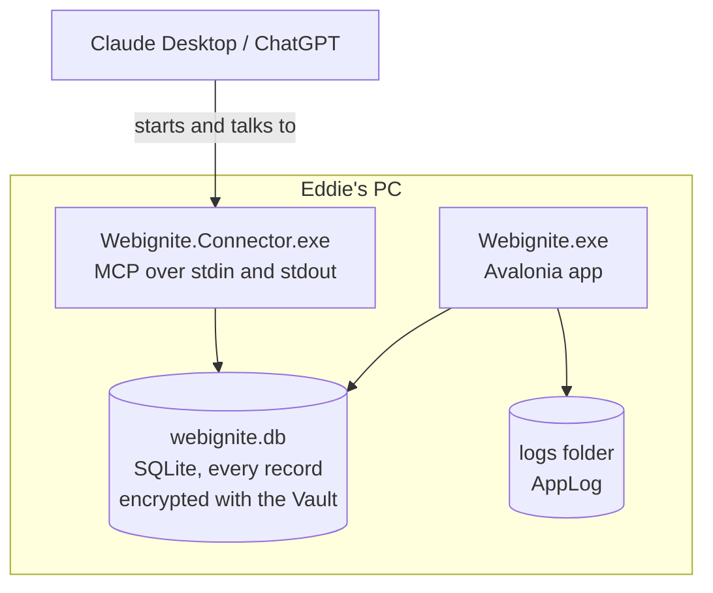
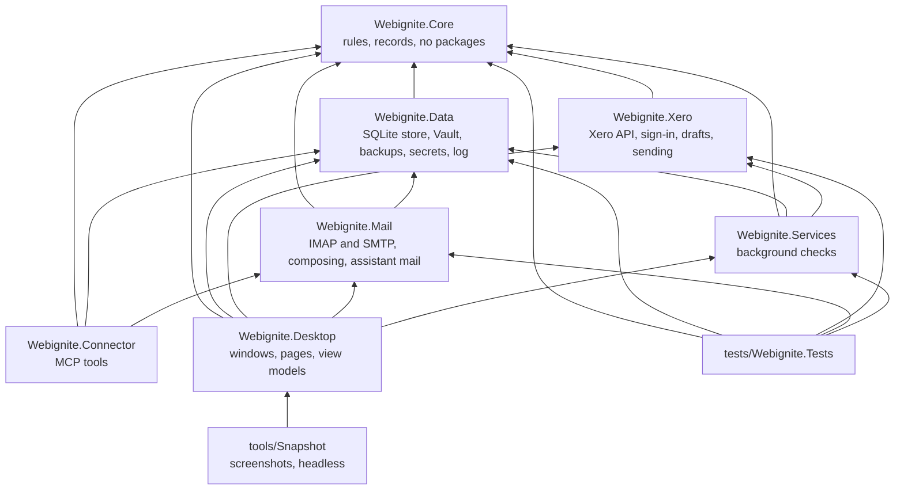
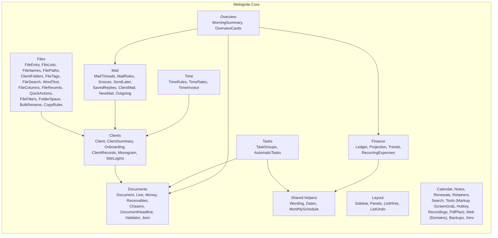
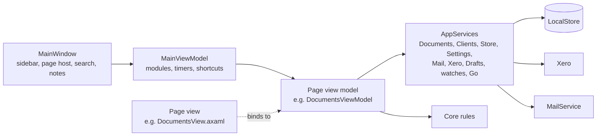
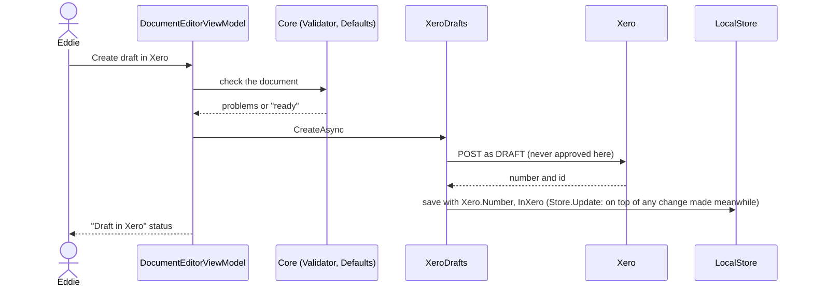
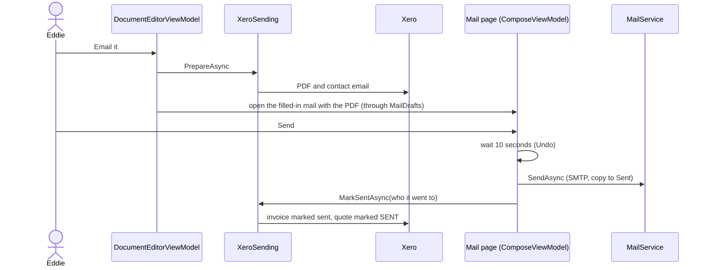
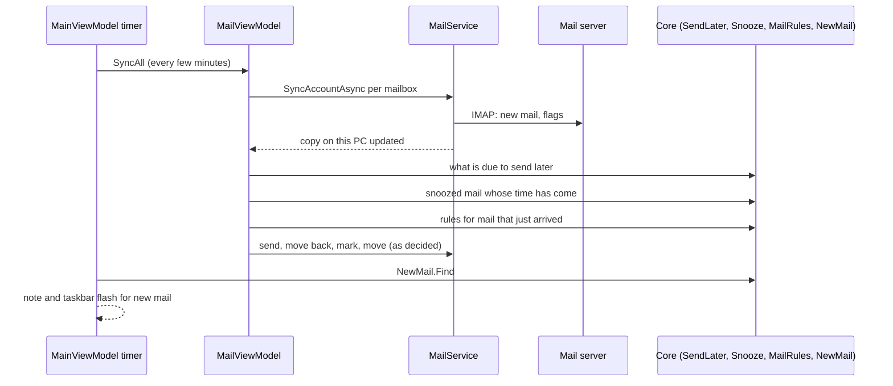
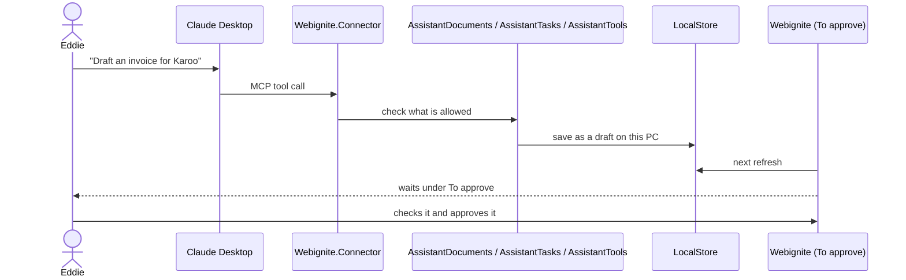

# How Webignite is put together

A map of the app in four levels, using the C4 model: what Webignite talks to, the programs it is made of, the parts inside each, and how the main jobs flow through them. The diagrams are Mermaid, so GitHub draws them. Keep this file up to date in the same PR when a project, a page, a store or an outside service is added or removed.

Recipes for adding things are in [adding-things.md](adding-things.md). The house rules are in [CLAUDE.md](../CLAUDE.md).

## 1. What Webignite talks to

One person (Eddie) uses one Windows PC. Everything is kept on that PC; outside services are only reached for the job they do.

| Outside service | What for | Where in the code |
| --- | --- | --- |
| Xero | Quotes and invoices go in as DRAFT; payments and statuses are read; PDFs fetched for emailing. Sign-in is OAuth with PKCE in the browser. | `Webignite.Xero` |
| Mail server | Mail is read over IMAP into a copy on this PC and sent over SMTP. | `Webignite.Mail` (MailKit) |
| Claude Desktop, ChatGPT | They start `Webignite.Connector`, which offers tools over MCP. | `Webignite.Connector` |
| Websites, Google PageSpeed, rdap.org, dns.google, Cloudflare DNS | Site check, uptime watch, domain and hosting reports. | `Webignite.Services`, `Core/Web` |
| OneDrive folder | Backups land in a synced folder, encrypted with a password. | `Webignite.Data/Backups.cs` |
| GitHub releases | Velopack checks for and downloads updates. | `Desktop/ViewModels/UpdateViewModel.cs` |
| Windows | Credential Manager holds mail passwords and the Xero sign-in; DPAPI protects the database key. | `Webignite.Data/Secrets.cs`, `VaultKey.cs`, `Webignite.Xero/WindowsCredentialStore.cs` |

## 2. The programs and projects

Two programs run on the PC, the app and the connector, and they share one encrypted database file.

### Projects and what may use what

Arrows point at what a project uses. Core uses nothing, so every rule in it can be tested on its own.

| Project | Holds | Outside packages |
| --- | --- | --- |
| `Webignite.Core` | Every business rule and record: documents, money, clients, mail rules, time, layout, `Notes` (notebooks, folders, search, the quick note) and `Writing` (formatted writing for the mail editor and notes, checklists included). Pure functions with dates passed in. | none |
| `Webignite.Data` | `LocalStore` (SQLite, one table per kind of record, payload encrypted by `Vault`; one file per area on the shared helpers in `LocalStore.Rows.cs`, and `LocalStore.Schedules.cs` for what the calendar calls for, `LocalStore.Upgrades.cs` for the steps that bring older data up to date), `VaultKey`, backups, secrets, `AppLog`, the assistant rules for documents and to-dos. | Microsoft.Data.Sqlite, ProtectedData |
| `Webignite.Xero` | `XeroSession` (sign-in, tokens), `XeroApi`, `XeroDrafts` (create and check drafts), `XeroSending` (PDFs, mark sent), `XeroStandings` (payments). | none |
| `Webignite.Mail` | `MailService` (sync, read, mark, move, send; `MailRetry` decides when a dropped connection is tried again), `MailComposer`, `MailReader`, `AssistantTools` (what an assistant may do with mail). | MailKit |
| `Webignite.Services` | `DocumentService`, `ClientService` and `NoteService`, through which pages read and change quotes, invoices, clients and notes (each change applied to the record as stored now); `PaymentWatch`, `XeroClientWatch`, `UptimeWatch`, `SiteChecker`: each has `Due(now)` and `RunAsync`. | none |
| `Webignite.Connector` | The MCP server and its tools: documents, to-dos, mail. Logs go to stderr only. | ModelContextProtocol, Hosting |
| `Webignite.Desktop` | The app: `AppServices`, `AppSettings`, `Navigator`, `MailDrafts`, `BackgroundJobs`, `MailCheck`, `TimerClock`, pages (view models and views), controls, styles. | Avalonia, CommunityToolkit.Mvvm, HtmlRenderer, Velopack |
| `Webignite.Tools` | The heavier tools: screen recording to MP4 (`Recording/`: `ScreenRecorder`, `VideoWriter`, `VideoFile`, through Windows' Media Foundation and WASAPI), PDF pages (`PdfPages`), PDF text and page counts (`PdfText`), putting files into one PDF (`PdfMaker`), building PDFs page by page with turns, words and a signature (`PdfEdit`, through PDFium), turning pictures and reading their size (`PictureTools`), picture shrinking (`ImageShrinker`), QR codes (`QrCodes`), and pictures decoded for the picture viewer (`PictureTools.ForViewing`). Only read from disk when a tool is first used. | Docnet.Core, QRCoder, Avalonia.Skia |
| `tests/Webignite.Tests` | xUnit v3 tests, one file per area. | xunit.v3 |
| `tools/Measure` | Opens the app on a year of made-up work and measures start-up time and memory, then opens and lets go of every page twice, checking each page and its screen are freed and nothing is left behind. Fails past `limits.json`; CI runs it and puts the numbers in the run's summary. | Avalonia.Headless |
| `tools/Snapshot` | Builds sample data in a throwaway database, saves a screenshot of each screen and runs checks along the way (a failed check fails the run). CI runs it on every pull request and keeps the pictures. | Avalonia.Headless |

## 3. Inside the projects

### Core: rules by area

Some rules are written once and used everywhere; a second copy is a bug waiting to happen. Days in words are `Wording`, weeks, months and tax years are `Dates`, anything monthly is `MonthlySchedule`, names are compared with `ClientDirectory.Key`, addresses are matched with `ClientMail`, websites become domains with `Web.Domains.Of`, and typed amounts are read with `Money.Parse`.

### Desktop: how a page is built

Every page is a `Module` in the sidebar: a view model (`ViewModels/ThingViewModel.cs`) shown by its view (`Views/ThingView.axaml`). View models call Core for decisions and `AppServices` for everything else.

| Piece | Job |
| --- | --- |
| `AppServices` | One of each long-lived thing: the store, `Documents` and `Clients` (the services pages use for those), settings, mail, Xero session, watches, `Navigator`, `MailDrafts`, notes, background work. |
| `MailDrafts` (`services.Drafts`) | The one way a mail is prepared for the person to send: invoice and quote mail, reminders, statements, onboarding reminders, mark-ups. Nothing is sent from code. |
| `IRefreshable` | A page that shows what other pages change reads it again when it is opened and on F5. |
| Open pages | A sidebar entry is a `Module`; what is open is a `PageHost`. Each module has its main copy (`Module.Main`), and a page can be open more than once (`MainViewModel.OpenAnother`, `Close`): two Mails, two Clients, each with its own state. `MainViewModel.Open` lists every open copy and `Current` is the one on screen; the sidebar and jumps go to the copy of a page used last. Telling pages something changed, and saving before the app closes, goes to every built copy (`Built<T>`). `MainViewModel.Tabs` (in `MainViewModel.Tabs.cs`) is the tab strip, shown once there are two: whatever comes on screen takes the place of what the tab showed unless it has a tab already, `OpenInNewTab` (Ctrl+click or a middle click in the sidebar, on a client, or a middle click on a mail) adds one, `CloseTab` won't close one with work open, and the tabs are saved under "tabs" when the app closes (`TabRules` in Core). A page that is `ITabTitle` names its tab after what is open in it. |
| Pop-out windows | `MainViewModel.PoppedOut` (in `MainViewModel.PopOut.cs`) holds pages taken out of the strip into windows of their own: drag a tab down out of the strip or out of the window, or right-click it and choose Open in new window. `MainWindow.PopOut.cs` makes a `PageWindow` for each and closes it when the page goes back; dragging a `PageWindow`'s header onto the main window's tabs puts the page back (`DockBack`), and closing the window closes the page, or puts it back when it has work open. Popped-out windows and where they were are saved with the tabs. The sidebar and jumps never take over a popped-out page: the main window gets its own copy. |
| Side by side | `MainViewModel.Beside` (in `MainViewModel.Split.cs`) is a second page beside the one on screen: drag a tab to the left or right edge of the page (`TabRules.SideAt`), or right-click it and choose a side. `MainWindow.Split.cs` lays the two out with a divider whose position is kept (`MainShare`). The page beside has its own header to swap sides, go back to being a tab, or close (one with work open goes back to a tab). The sidebar, tabs and jumps act on the main side and never take over the page beside; the split is saved with the tabs. Each side keeps a usable minimum width and scrolls sideways below it. Each side has a header with its page, Swap sides, Open in a window of its own and Close this side (the page beside also has Back to a tab); dragging a header to the other side swaps, onto the tabs makes the page beside a tab, and out of the window or down into the page pops it out (`TabRules.DropSide`). Closing the main side leaves the page beside in the whole window. |
| Light by design | A page is built the first time it is opened (`PageHost` holds how to build it), so starting the app builds Overview and nothing else. A page nobody has looked at for `MainViewModel.PageIdle` is let go (`ReleaseIdle`) unless it is `IHoldsWork` with work open; a page that must tidy up (stop a timer, save typing) is `IDisposable`. Mail checks, payments, website checks and backups run in `BackgroundJobs` whichever pages are built, and only tell pages that are; `MailCheck` does the mail part without the Mail page. The running time-tracking timer is `TimerClock`, so the sidebar shows it with Time closed. Nothing at start-up touches a type in `Webignite.Tools`; the screenshot tool checks both. |
| `MainViewModel.PrepareToCloseAsync` | Runs before the window closes: saves open editors, the open client and typed amounts, sends a mail still in its undo wait and saves the mail being written. |
| `AppSettings` | Typed settings saved as JSON under a key in the `settings` table, e.g. `mail-rules`, `mail-snooze`, `income-plan`. |
| `Navigator` (`services.Go`) | Moving between pages and opening a client, a document or a mail, without pages knowing about each other. |
| `Background.Forget` | Runs a task nobody waits for and writes any failure to `AppLog`; with `tell: true` a note says so too. `Background.CatchUnhandled` does the same for any error nobody caught on the screen's thread, and the app carries on. |
| `Feedback` | Timings for small movements (fades, the to-do tick), following the Motion setting. |
| Controls | `PanelGrid` (movable panes), `Sticky` (pinned table headings, on by the `stickyhead` class), `AgendaChip` (a calendar item coloured by kind), `RichTextEditor` (the mail editor, see below), `ListKeys` (arrow keys on lists), `EmptyState`, `ListHint`, `SavedNote`, `Monogram`, `CategoryDot`, `Icon` and `IconConverter`, `Spinner`, `Sparkline`, `ShareBar`, `IncomeChart`, `MarkupCanvas`. |
| Styles | `Palette.axaml`, `Palette.Light.Asana.axaml` and four dark palettes (Graphite, Midnight, Warm, Asana; the only place colours live, shadows, mark-up pens and the 16 project colours included). The Asana pair is read from Asana's own design tokens; Settings > Light and dark picks a light look and a dark look (`AppearanceSettings.LightPalette`, `DarkPalette`, swapped by `Palettes.Apply`), `Controls.axaml`, `Icons.axaml` (Lucide), `Motion.axaml`, and `Views/AgendaChips.axaml` for calendar chips. |
| Shared screen pieces | `Views/LinesEditor` is the lines table on quotes, invoices and retainers. `ClientPicker` builds the client lists pages offer (names to type from, or a drop-down with a first choice like "All clients"). |
| Writing a mail | `ComposeView` holds the format bar and a `RichTextEditor`, which edits a `RichDocument` (`Core/Writing`). Every edit goes through `RichEditing`, which has the tests. `RichHtml` writes the mail's HTML and reads drafts back. `RichText` turns plain text in (templates, saved replies) and out (the text part). The signature is ordinary writing, marked `IsSignature`, so it can be edited, swapped when From changes, and is never added a second time. A draft written here keeps its HTML in a `webignite-body` div, so it reopens exactly. Templates (`MailTemplates` in Core, kept in the `mail-templates` setting) are whole mails without the signature; using one fills only what's empty and adds the mailbox's own signature. {name} comes from Contacts first (`SavedReplies.FirstName`). The Contacts button by To lists `AddressBook.Pick` and adds with `AddressBook.Add`, skipping anyone already there. Spell check: `Spelling` (Core) decides which words are checked (no addresses, numbers, codes or names with capitals inside) and the language (en-ZA, then en-GB, en-US); `WindowsSpelling` asks Windows' own checker, opened by `services.Spelling` the first time an editor needs it. `RichTextEditor.Spelling.cs` draws the wavy lines and puts suggestions, add and ignore at the top of the right-click menu. The signature isn't checked. |
| Files page | An explorer for the whole PC, with the client folders (Settings, Files; `C:\Projects` when it is there) first in its side list. `FilesViewModel` shows one folder, watched while on screen; its changes (new folder, rename, copy, cut and paste, Recycle Bin) are in `FilesViewModel.Actions.cs` and each is recorded as a `FileChange` so Ctrl+Z puts it back. Disk work is in `Files/FileOps.cs`; Open with, Properties, Show in Explorer and Windows' own right-click menu (More options) are in `Files/WindowsShell.cs`. `FilesView` drags files in and out (to Explorer or Outlook), puts copied files on Windows' clipboard, and draws thumbnails only for pictures in sight; closing the page stops the watcher and lets every thumbnail go. A folder opens from elsewhere with `services.Go.Folder`. A client's page finds their folder by name (`ClientFolders`), asks about a near match, and keeps the answer in `Client.Folder`. Tags (`FileTags` in Core) are named and coloured in Settings, Files, and kept per file in the `file_tags` table through `services.FileTags` (`Files/FileTagBook.cs`, read on first use and held in memory). Each tagged file keeps its Windows file id (`Files/FileIdentity.cs`), so a file renamed or moved in Explorer on the same drive is found again; one moved, renamed or copied in Files takes its tags with it straight away. A tag's spot in the side list shows its files from every folder (`FilesViewModel.ShowingTag`); the Tags button filters a folder, and Group has By tag. The parts taken from Finder are in `FilesViewModel.Finder.cs`: search as you type (`Files/FileSearcher.cs` searches a folder and everything below it off the screen's thread, names and, when asked, the words inside PDFs, Word and text files through `Files/FileReading.cs`); the details pane and Quick Look (Space), both a `FileLookViewModel` that draws a picture, PDF pages or text and lets them go when the pick changes; column view (`FileColumns.Chain`, each folder on the way a `FileColumnViewModel`, the folder you're in being the list itself); Favourites (in `FileSettings`) and Recents (the `file-recents` setting); and quick actions on right-click (`Files/QuickActionRunner.cs`: turn a picture, a web-sized copy, put files into one PDF, zip), which Undo puts back. The power tools are in `FilesViewModel.Power.cs`: the Show filter (`FileFilters`, by kind and date), Space (every folder's size added up off the screen's thread, biggest first, with its share), renaming many at once (`BulkRename` in Core, `FileOps.RenameMany` renames through passing names so names can swap, and Undo puts them all back), and the copy queue (`Files/CopyQueue.cs`, `services.CopyQueue`): folders and anything over 50 MB (`CopyRules`) are copied one job at a time off the screen's thread, shown in a bar every Files tab shares, with Pause, Carry on and Stop. A stopped copy keeps whole files; a stopped move leaves the originals. The picture and PDF work is in `Webignite.Tools` (`PictureTools`, `PdfMaker`, `PdfText`), read from disk only when one of these is first used. |
| The app's own explorer everywhere | Every Open, Save and pick-a-folder in the app goes through `Files/Picker.cs`, which shows `FilePickerWindow`: the Files explorer (a `FilesViewModel` in picking mode: `PickFilter` shows only the files that fit, `PickFile` picks instead of opening) with a bar to Open, Save (asking before replacing; `FilePicking` in Core adds the ending and makes the name safe) or Use this folder. The next pick starts where the last one ended (`FileSettings.LastPicked`). The explorer goes when the box closes. "Show in folder" and "Open the folder" anywhere in the app open Files (`services.Go.ShowFile` picks the file there), not Windows Explorer; Files' own right-click keeps Show in Explorer for when Windows' is wanted. |
| Screenshots | A shortcut from any program (Settings, Screenshots; Ctrl+Alt+S to start) is a `GlobalHotkey` on the main window (`Files/ScreenCapture.cs`, Windows' RegisterHotKey). `MainWindow.Screenshots.cs` freezes the monitor under the mouse (`ScreenCapture.Grab`, GDI) and shows it in a `ScreenGrabWindow`: drag for an area, click for the window under the mouse, Enter for the whole screen, Esc to stop (`ScreenGrab` in Core). The part picked opens in Mark-up, which has text and blur besides notes, arrows, boxes, highlight and pen (`Markup` in Core: a blur is squares of averaged colour, so nothing under it can be read back). From there it is copied, saved in the client's folder (or Screenshots), added to the to-do list with where it is saved, or mailed. |
| Screen recording | The recording shortcut (Ctrl+Alt+R) or Mark-up's Record the screen uses the same picker, then `MainWindow.Recording.cs` starts a `ScreenRecorder` (`Webignite.Tools/Recording`): screen frames grabbed with GDI about 20 a second with the pointer drawn in, the microphone through WASAPI, both written to an MP4 by Windows' Media Foundation (`VideoWriter`; H.264 and AAC). A `RecordingBar` shows the time and Stop, with a red line round the area. Stopping opens the recording in Mark-up (`RecordingViewModel`): two handles pick the start and end with a frame to see, and saving makes a trimmed copy (`VideoFile.Trim`) in the client's folder, elsewhere, or attached to a mail. The video work is behind `IVideoTools` (`Files/WindowsVideo.cs`), so the screenshot tool can stand in for it; `VideoTests` checks the real thing on the Windows build. |
| PDF tools | `PdfViewModel` (page `PDF tools`, opened from Files' right-click, a mail attachment's preview, or by dropping files): pages from one or more PDFs and pictures as small pictures to drag into order, turn or take out (`PdfPlan` in Core), then saved (over the first file, the old one to the Recycle Bin) or saved elsewhere. Pages can go into a PDF of their own, be split, made into a smaller copy, or saved as pictures. Fill in and sign (`PdfFillViewModel`) shows one page large to put text, the date and a signature on; the signature is drawn once and kept (the `signature` setting). The work is `PdfEdit` in `Webignite.Tools`, calling PDFium (which Docnet brings) to build a new PDF each time; the files opened aren't changed until saved. |
| Notes | `NotesViewModel` (page `Notes`): notebooks and their folders, the notes in the one picked or found by a search (`NoteRules.Search`, every word, accents and case aside), and the open note in a `RichTextEditor` with headings, lists, checklists (`ListKind.Check`; click the box to tick), links, pictures and tables. Typing is saved a moment after it stops, when another note opens, and in `PrepareToCloseAsync`. Every change goes through `services.Notes` (`NoteService`), which raises `Changed` so other open copies of the page (and the client page) catch up. A note can be about a client: it shows in the Notebook notes card on their page (`ClientDetailViewModel.Notes.cs`), and `services.Go.Note` opens it. Deleted notes wait 30 days in Deleted. The quick box (Ctrl+Alt+N from any program, Settings, Notes) is a `GlobalHotkey` that opens `QuickNoteWindow` (`MainWindow.QuickNote.cs`): what is typed becomes a note, a to-do (with a due day) or a calendar event (a day and an optional time or range), by the rules in `QuickCapture` (Core). Whatever is typed is kept when it closes unless Discard is pressed; an event whose time can't be read is kept as a note when the box closes anyway. Shared notebooks come with sync. |
| Calendar and Planner sizes | Calendar fills the window (`CalendarView`, full-bleed) unless the month is dragged shorter by the handle under it (double-click fills again); the divider beside it sizes the day panel. Planner's handle under the week sets how tall the days are, and a day scrolls when it holds more. Sizes are `CalendarSizes` (Core, `Layout/CalendarSizes.cs`, kept within bounds by `CalendarSizing`), saved in the setting `calendar-sizes`. |
| Planner section | The Asana-style part of the app. Its pages are `Module`s marked `InPlanner` (Home, Projects, To-do, Calendar, Week, Time): the main sidebar shows only the Planner entry (`SectionLink`), and opening any Planner page swaps the sidebar for `SidebarViewModel.PlannerItems` (a `SidebarBack` arrow, Home, My tasks, Projects, `NavHeading`s WORK and PLAN, the project links). The window has two list boxes, shown one at a time, so each keeps its pick. Another page, or the back arrow, puts the main sidebar back. A project has a look (`ProjectLooks` in Core): an icon (Asana's 32, drawn as `Project.{name}` in `Icons.axaml`) and a colour (Asana's 16, the palette's `Project{name}` brushes with a near-black `OnProject` picture on top, picked from its name until one is chosen; looks stored under older names are mapped to the nearest new one), a status (`ProjectHealth`: On track, At risk, Off track) and a star; starred projects come first in the sidebar, each shown as its coloured square. The project's header has the square (click to pick a colour and icon), the name, a menu (Save as template, Delete, Close), the star, Set status, the members' faces, and List and Board as tabs. Home (`PlannerHomeViewModel`) is laid out as Asana's: the date and greeting, tasks completed this week, a My tasks card with Upcoming, Overdue and Completed tabs, and a Projects card with Create project and the projects changed lately (`PlannerHome` in Core). |
| My pages | `MyPagesViewModel` ("All my pages" in the sidebar): pages the person puts together from widgets, saved in the setting `my-pages` as `MyPage`s (Core, `Layout/MyPages.cs`). A page is a grid of twelve columns (`WidgetGrid` in Controls, rows a fixed height, columns sharing the width); a widget dropped or grown onto others pushes them down, and all slide up into room above (`MyPages.Move`, `Resize`, `Reconcile`), so there are no overlaps or holes. Arrange turns on dragging by the heading and sizing from the corner (`MyPagesView.axaml.cs`); each step is worked out from the page as it was when the drag started and saved on letting go. Each widget's `WidgetBody` (`Widgets.cs`) is built when its page opens and disposed when it closes: My tasks and a project's open tasks (`TasksBody`, ticked off in place), Today, This month, a note (kept a moment after typing stops), the calculator, clipboard history and colours (one `ToolsViewModel` per page, shown with the tools' own views), the timer (`TimerClock.StopAndKeep`), a client's card, Needs you (`MorningSummary` from `Summaries.Input`, the same as Overview) and the newest mail across the inboxes (`Summaries.Inbox`). The sidebar's My pages group lists each page and New page (`MainViewModel.MyPages.cs`, `MyPageLink`, the same `SubLink` entries as the Projects group via `SidebarViewModel.ShowLinks`); `services.MyPagesChanged` keeps the sidebar and other open copies up to date. |
| Client page | `ClientDetailView`: the Details card, and everything else in one card of folding rows (`FoldList` and `FoldSection` in Controls): To-do and coming up, Quotes and invoices, Mail, People, New site checklist, Projects and time, Site logins, Files and notes. Each row shows a one-line summary while closed (`ClientDetailViewModel.Sections.cs`, red when something is overdue). The order and which are open are the same for every client and remembered (`SectionsViewModel`, `Core.Layout.Sections`, setting `sections` under "client"); a row moves by dragging its grip or from its right-click menu. In a pane narrower than 860 the rows go under the details. |
| Clients from Xero | `XeroClientWatch` (Services) reads Xero's contacts (`XeroApi.CustomersAsync`: name, email, person, phone, address, website) when the app starts and every four hours, and from Bring in from Xero on Clients. `XeroClients.Plan` (Core) matches each contact to a client by its Xero contact id, else by name: a match only has its blank details filled, so what was typed here stays; an active customer nobody matches becomes a new client. Suppliers and archived contacts aren't brought in. Xero itself is never written to. |
| Ctrl+K | `QuickSearchViewModel` reads clients, quotes, invoices, to-dos, renewals, notes and site logins when the box opens, then mail and file names off the screen's thread (`Files/FileIndex.cs`: recent files and up to 20 000 names in the client folders, six levels down, skipping code and cache folders by `FileSearch.SkipWhenIndexing`). Files are also found by their tags (from `services.FileTags`) and, once typing stops for a moment, by the words inside them (`FileSearcher` over the client folders, cancelled as typing carries on); each source is kept apart in the view model and joined when the list is drawn, so one arriving late never pushes out another. `QuickSearch.Find` (Core) ranks them; a site login is matched by site, address, username and notes, never its password, and opens its client. All of it is let go when the box closes. |
| Clipboard history | `services.Clipboard` (`Files/ClipboardKeeper.cs`) keeps the last 25 things copied in any program (text, and pictures as PNG, the newest 8), in memory only, by Windows' clipboard listener on the main window (`AddClipboardFormatListener`, no polling). Copies marked private (`ExcludeClipboardContentFromMonitorProcessing`, which `SecretClipboard` and password managers set) are skipped. `ClipboardHistory` (Core) keeps the list; the Clipboard history tool window (`ClipboardView`) follows it only while it's open, with a search box, and opens from any program on Ctrl+Alt+V (Settings, Screenshots). |
| Colour picker | Ctrl+Alt+C from any program (Settings, Screenshots) or Pick from screen in the Colours tool calls `services.Go.PickColour`: `MainWindow.Colours.cs` first minimises the app when the pick starts from inside it (so a website behind it can be picked), then freezes every monitor, each under its own `ColourPickWindow`, a loupe (`ColourLoupe` in Core) that reads only the pixels round the pointer. The colour clicked is copied as its code and handed back to the Colours tool, or offered in a note, and goes to the top of the recent colours the Colours tool shows. `GlobalShortcuts.TakenBy` stops two shortcuts from any program sharing keys. |
| Picture viewer | Pictures opened from Files (Enter or double-click), a client's linked files or a mail attachment open in `PictureWindow` (`MainWindow.Pictures.cs`, one window, reused) through `services.Go.Picture`. `PictureViewModel` holds only the picture on screen, decoded off the screen's thread by `PictureTools.ForViewing` (turned the way the camera meant it, shrunk to 4096 pixels on its longest side) and let go when another is shown or the window closes. It fits the window until zoomed by hand (`PictureViewing` in Core: fit, zoom steps, the folder's pictures in name order for ← and →). The Edit menu (`PictureViewModel.Edits.cs`): crop (drag over the part to keep, `CropFrame` dims the rest), resize (width or height, shape kept), turn and flip change the file, each through `EditInPlace`, which keeps a copy first so Undo puts the file back exactly; convert to WebP, PNG or JPG (`ImageShrinker.Convert`, beside the original) and shrink for a website (`ImageShrinker.Shrink`, in a web folder) make a new file and show before and after with the sizes, to keep, open or throw away; pick a colour copies the code of the pixel clicked and adds it to the recent colours (`Colours.Remember`, setting `recent-colours`). `PictureEditing` (Core) turns a drag into the picture's own pixels and works out the new size. Delete asks and sends it to the Recycle Bin, and Copy, Mark-up, Show in Files and Open in another program are on the bar and the right-click menu. Space in Files still shows the quick preview. |
| One copy, and opening from Windows | `Program.Main` asks `SingleCopy.Claim` first: a second start (the Start menu, or a picture double-clicked in Explorer) hands what it was opened with to the running copy over a named pipe and stops, so two copies never share the data; if the first copy is closing (a restart after a restore), the second waits for it. The running copy (`SingleCopy.Listen`, started in `App` once the window is up) comes to the front and shows the picture. A picture on the command line at start is shown too (`PictureAssociation.PictureFrom`). Settings, Files, Pictures offers Webignite to Windows for pictures (`Files/PictureDefault.cs` writes `PictureAssociation.Entries` under HKEY_CURRENT_USER: a ProgID, Open with, and registered-app capabilities pointing at the installer's launcher, which stays put through updates) and opens Default apps on Webignite, where the person picks it; Stop offering takes it all away. |
| Contacts | Page `Contacts` (`ContactsViewModel`): everyone, by search and group, and one person open on the right to change (several emails and numbers with what each is for, role, client or company, groups, notes). A person is a `Person` (Core, `Contacts.cs`), kept in the `contacts` table and changed through `services.Contacts` (`ContactService`). A person can be with one client; on the client's page the People card (`ClientDetailViewModel.People.cs`) lists them and picks the contact person (`Client.MainContactId`) and who gets quotes and invoices (`Client.BillingContactId`). Their name, number and address show on the client by `ContactRules.Mirror`, and the client page's contact person, number and first address go back to them (`ClientService.SaveDetails`, which takes only the fields typed over, so a change from Contacts meanwhile isn't undone). The first time Contacts is read, each client's existing contact person becomes a person (`ContactRules.FromClientDetails`, once, setting `contacts-made`). Ctrl+K finds people. In Mail, To, Cc and Bcc suggest people in Contacts first (`AddressBook.Build` takes them, with the name typed there) and groups, which put everyone in them at once (`AddressBook.Insert`); the address book is rebuilt when Contacts change. A mail's right-click adds the sender to Contacts (`ContactRules.FromSender`, with their client when the address is a client's) or opens them there. The Contacts page suggests people mailed often who aren't in it yet (`ContactRules.MailedOften`), and a person shows their latest mail (`ContactRules.InvolvedIn`, read off the screen's thread) and their client's quotes and invoices. Import and Export (`ContactsViewModel.Files.cs`) read and write vCard (versions 2.1 to 4.0, as phones, Outlook and Google write them) and CSV (Webignite's own, Outlook's and Google's headers; commas or semicolons) through `ContactFiles` (Core); importing skips anyone already in Contacts by an address (or by name when they have none) and links the client whose name is their company. Nothing syncs. |
| Projects (groundwork) | You and your partner are `TeamSettings` (Core, `Projects.cs`; setting `team`), made the first time `services.Team()` is read as "Me" and "Partner" and named in Settings, Projects. Ids never change, so names can. A `Project` (shared or personal, optional client, status, due date), its `Heading`s and its `ProjectTask`s (a subtask is a task with `ParentId`, one level deep) are kept in the `projects`, `project_headings` and `project_tasks` tables and changed only through `services.Projects` (`ProjectService`). Every record is `ITracked`: who made it, who changed it last, and per field who changed it last (`ProjectRules.Stamped`, which stamps only the fields whose value changed), so phase B sync can let the later change of each field win. Deleting leaves a marker (`Deleted`, with who and when) instead of removing the row, so a deletion can sync; `Restore` is Undo. `Changed` carries the project's id. The page `Projects` (`ProjectsViewModel`, "Projects" in the Planner sidebar) lists shared and personal projects (`ProjectRules.Listed`) and shows the open one as rows: a `SectionRow` per heading (`ProjectRules.Sections`, tasks under no heading first), its `TaskRow`s, and an `AddTaskRow`. Ticking, giving a task to someone and dating it save at once; names and titles a moment after typing stops (and in `Keep`, which `PrepareToCloseAsync` calls). A task is dragged by its grip (`ProjectsView.axaml.cs`) or moved from its right-click menu; `ProjectRules.PlaceAt` works out its new order. The page's own changes update it in place; a change from another copy of the page reloads it. A task opens in a third pane (`TaskDetail` in `ProjectsViewModel.Task.cs`): title, done, who it's for, start and due, heading, notes, subtasks (`TaskRow`s with no heading), and what it's about: a client, a quote or invoice (`ProjectRules.DocumentsFor`, the client's first) and a mail (`TaskMail`, found by searching cached mail off the screen's thread, and found again by its message id when it has moved). The foot says who made it and who changed it last (`ProjectRules.History`). In a window narrower than 1400 the project list is tucked away while a task is open. List or Board (`IsBoard`, remembered in `project-view`): the board is `Columns`, a `BoardColumn` per heading made from the same `TaskRow`s and `AddTaskRow`s as the list, so a card is dragged with the same code (dropped on a card it goes above or below it, on a column's empty space to its end). A task has a `TaskPriority` (High, Normal, Low) and tags, set in the task pane (`ProjectRules.Tags` tidies what's typed); rows and cards show them. The filter above the list and board picks a priority and a tag (`ProjectRules.Shows`), and a task added while filtered takes the filter (`ProjectRules.Filtered`) so it stays in view. My tasks (top of the project list, `IsMyTasks`) lists open tasks and subtasks given to me in live projects (`ProjectRules.Mine`), grouped Overdue, Today, This week, Later, No due date (`ByWhen`); a task opens beside it. The dated ones go into Calendar, Planner and Today as `AgendaKind.ProjectTask` (`services.Projects.Agenda`, passed to `Agenda.Build`). A mail's right-click adds it to a project (`ProjectRules.FromMail`, linked and given to me), and `services.Go.ProjectTask` opens a task from anywhere. The task pane starts the Time page's timer on the task, with its client (`ProjectRules.TimerNote`). A task can repeat (`TaskRepeat`); ticking it off makes the next one in the same save (`ProjectService.ChangeTask`, `ProjectRules.Next`, skipping ahead when ticked late), with its subtasks fresh. Save as template keeps a project's headings, tasks and subtasks with dates as days from its start (`ProjectRules.TemplateOf`, setting `project-templates`); the arrow next to +, or Templates in the sidebar (`IsTemplates`, a `TemplateRow` each), starts a project from one (`ProjectService.AddFromTemplate`). The sidebar's Projects group (`MainViewModel.Projects.cs`) has My tasks above All projects, and each running project and Templates below it, as `ProjectLink`s that follow the page wherever it is moved (`SidebarViewModel.ShowLinks`); clicking one opens that part of the page, and the page's `Showing` marks the entry for what is on screen. Nothing syncs yet. |
| Site logins | The Site logins card on a client's page (`ClientDetailViewModel.Logins.cs`) holds any number of logins: a site name, where to sign in, username, password and notes (`SiteLogin` in Core; `SiteLogins` checks them and only ever opens an http or https address). They go through `services.Clients` (`Logins`, `SaveLogin`, `DeleteLogin`) into their own `site_logins` table, not the client record, so they never travel with a client to assistants, the connector or Xero. A password shows as dots until Show, and Copy puts it on the clipboard through `SecretClipboard`, which asks Windows to leave it out of clipboard history and cloud sync and clears it after 30 seconds. Deleting a client deletes its logins in the same go, and Undo puts both back. |
| Mail page | `MailView` with the folder tree (`MailFolderNodes.cs`), the list (`MailRowViewModel`) and the reader; `MailRulesView` and `MailSetupView` are its two pages of their own. `MailViewModel` is split by job into partial files (Actions, Editors, Rules, Sending, Snooze). The reader keeps its top short (subject, sender with a Details toggle for To and Cc, date, Reply), gives the mail the room, and puts the attachments (chips: click to show, right-click to open, save as, save in the client's folder, or open in the PDF tools) and then the conversation underneath; both fold up and stay folded (`MailViewSettings`). The right-click menu on a mail (the list or the reader's top) also opens it in a new tab or window, writes to the sender, copies their address, opens or adds their client, makes a to-do of it, saves it as an .eml file, and selects all (`MailViewModel.Menu.cs`). A folder's menu has Mark all as read. |

### Pages

| Group | Pages |
| --- | --- |
| (top) | Overview, To approve, Mail, Planner (opens the Planner sidebar) |
| My pages | All my pages, each page the person made by name, New page (all one page; see My pages above) |
| Client work | Clients, Contacts, Retainers, Domains and hosting |
| Billing | Quotes, Invoices, Money, Reports |
| Planner (its own sidebar) | Back arrow, Home, My tasks, Projects, WORK (each running project, Templates, + for a new project), PLAN (To-do, Calendar, Week, Time) |
| Computer | Files, PDF tools, Notes; the tools Calculator, Password generator, Colours, Clipboard history |
| Web tools | Site check, Mark-up; the tools Website images, QR code |
| (bottom) | Settings |

A tool in the sidebar is a `ToolLink`, not a page: clicking it opens the tool in a small `ToolWindow` of its own (`MainWindow.Tools.cs`, one window per tool, above the app, closed with it), with a fresh `ToolsViewModel` that goes when the window closes. Each tool's screen is its own view (`CalculatorView`, `PasswordView`, `ColourView`, `QrView`, `ImagesView`). The calculator takes clicks on its pad, typing and the number pad; Enter works it out and carries on from the answer. When the app adds a sidebar group, a saved order of the person's starts afresh (`Sidebar.Reconcile`), so the new group gets its pages.

### What is stored where

| Table | Holds |
| --- | --- |
| `documents` | Quotes and invoices (`StoredDocument`): the document, then its `Xero` link and what Xero last said, its `Delivery` (approved, emailed, chased) and `Settled` (when and how). |
| `clients` | Clients with notes, files, their folder on the PC, projects, onboarding, hourly rates, and which person is the contact person and gets the invoices. |
| `contacts` | People: names, emails and numbers with labels, role, company, client, groups and notes. |
| `file_tags` | Files and folders with tags from Files: the path, the tag ids and the Windows file id, all encrypted. The tags themselves are the `file-tags` setting. |
| `site_logins` | Clients' site logins (site, address, username, password, notes), encrypted like every row, with the client's id inside the encrypted part. |
| `notebooks`, `notes`, `note_bodies` | Notebooks with their folders; each note's title, words (for search), client, pin and checklist count; and, apart, its writing as HTML with pictures inside, read only when the note is opened. |
| `tasks`, `events` | To-dos and calendar events. |
| `entries`, `recurring` | Money in and out, and monthly costs. |
| `retainers`, `drafts_made` | Retainers and which monthly drafts were already made. |
| `renewals` | Domains and hosting renewals. |
| `time_entries` | Logged time. |
| `mail_accounts`, `mail_folders`, `mail_messages`, `mail_bodies` | The copy of the mail on this PC. |
| `settings` | Every `AppSettings` record, by key. |

Every row's payload is JSON encrypted by the `Vault` with a key tied to the row, so a row can't be copied into another. Only what the database needs to find rows (ids, kinds, dates) is in the clear.

## 4. How the main jobs flow

### A quote or invoice goes to Xero

### An invoice is emailed

Approving the invoice and marking it sent are the only Xero writes that aren't drafts, and they happen only from the person's own click on Email it. Claude and ChatGPT never get this far.

### Mail arrives

### An assistant prepares something

### Payments and sites are checked in the background

`MainViewModel` ticks every minute and asks each watch whether it is `Due(now)`. `PaymentWatch` reads open invoices from Xero and `Receivables.Apply` decides what changed; `UptimeWatch` visits watched sites and `Uptime` decides what to say. Findings come up as notes in the corner and lines on Overview.

## Where new code goes

| Adding | Put it in |
| --- | --- |
| A rule, calculation or decision | `Webignite.Core/<Area>`, with a test in `tests/Webignite.Tests` |
| A new kind of record that is saved | Core record + a table and `LocalStore.Thing.cs` in `Webignite.Data` |
| A setting | A record in Core (or `Desktop` when it is only about the app), a property on `AppSettings` |
| A mail the person sends | `services.Drafts` (`MailDrafts`) |
| Work that mustn't be lost when the app closes | A line in `MainViewModel.PrepareToCloseAsync` |
| A page | View model, view, icon, `Page` value, `Module` in `MainViewModel` |
| A background check | A class in `Webignite.Services` with `Due` and `RunAsync` |
| Something an assistant can do | A tool in `Webignite.Connector`, its rule in `Assistant*` |
| A colour | All six palette files |
